# Konteneryzacja usługi LLM (Docker & Docker Compose)
Projekt realizuje wdrożenie modelu językowego w formacie `llamafile` wewnątrz izolowanego kontenera Docker na maszynie wirtualnej Ubuntu. Usługa zastępuje natywną jednostkę `systemd` z poprzedniego zadania, wystawiając REST API wyłącznie na interfejsie prywatnym `Host-Only`.

1. **Wyłączenie usługi `systemd` i zwolnienie portu 8080**

```bash
sudo systemctl disable --now llamafile
```

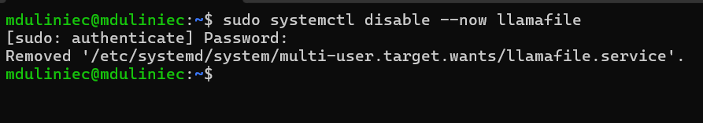

2. **Sprawdzenie silnika Docker i włączenie autostartu:**

```bash
docker --version
sudo docker compose version
sudo systemctl enable --now docker
```

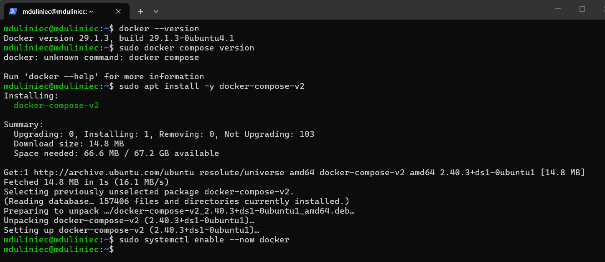

3. **Utworzenie katalogu projektu i pliku `Dockerfile` :**

```bash
mkdir -p ~/llamafile-docker && cd ~/llamafile-docker
cat > Dockerfile <<'EOF'
FROM debian:trixie-slim AS build
ARG LLAMAFILE_URL
ARG LLAMAFILE_SHA256
RUN apt-get update \
 && apt-get install -y --no-install-recommends ca-certificates curl \
 && rm -rf /var/lib/apt/lists/*
RUN curl -fsSL -o /model.llamafile "$LLAMAFILE_URL" \
 && echo "$LLAMAFILE_SHA256  /model.llamafile" | sha256sum -c - \
 && chmod +x /model.llamafile

FROM debian:trixie-slim
RUN useradd --system --create-home llamafile
COPY --from=build /model.llamafile /opt/llamafile/model.llamafile
USER llamafile
EXPOSE 8080
ENTRYPOINT ["sh", "/opt/llamafile/model.llamafile", "--server", "--nobrowser", "--host", "0.0.0.0"]
CMD ["--port", "8080"]
EOF
```

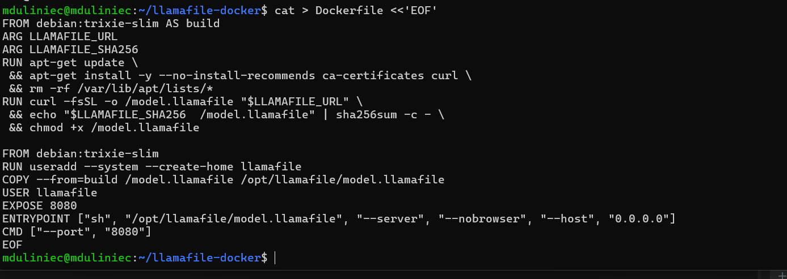

4. **Utworzenie pliku `compose.yaml`:**

```bash
cat > compose.yaml <<'EOF'
services:
  llamafile:
    image: ${IMAGE}
    build:
      context: .
      args:
        LLAMAFILE_URL: ${LLAMAFILE_URL}
        LLAMAFILE_SHA256: ${LLAMAFILE_SHA256}
    container_name: llamafile
    restart: unless-stopped
    init: true
    command: ["--port", "${PORT}", "-t", "${THREADS}"]
    ports:
      - "${BIND_ADDR}:${PORT}:${PORT}"
    mem_limit: 1536m
    cpus: 2.0
    healthcheck:
      test: ["CMD", "bash", "-c", "exec 3<>/dev/tcp/127.0.0.1/${PORT} && printf 'GET /health HTTP/1.0\\r\\n\\r\\n' >&3 && head -n1 <&3 | grep -q ' 200 '"]
      interval: 15s
      timeout: 5s
      retries: 3
      start_period: 60s
EOF
```

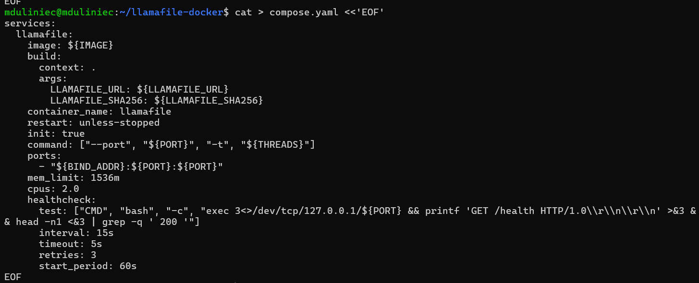

5. **Konfiguracja zmiennych środowiskowych (`.env.example` i `.env`):**

```bash
cat > .env.example <<'EOF'
IMAGE=ghcr.io/mduliniec/llamafile-llm:1.0
LLAMAFILE_URL=https://huggingface.co/Mozilla/TinyLlama-1.1B-Chat-v1.0-llamafile/resolve/main/TinyLlama-1.1B-Chat-v1.0.Q4_K_M.llamafile
LLAMAFILE_SHA256=29eca81f9f3a639029aa1f35cb1f28a9411aafbc54f12b920ca904177177a965
BIND_ADDR=192.168.56.10
PORT=8080
THREADS=2
EOF
cp .env.example .env
```

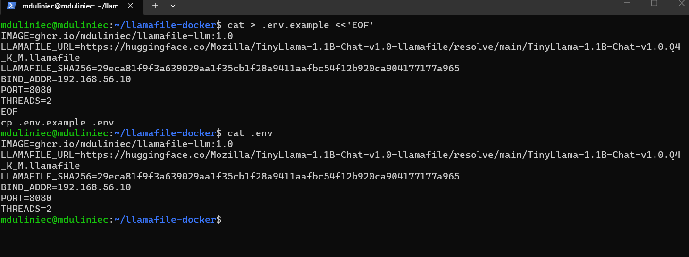

6. Budowanie obrazu i uruchomienie kontenera

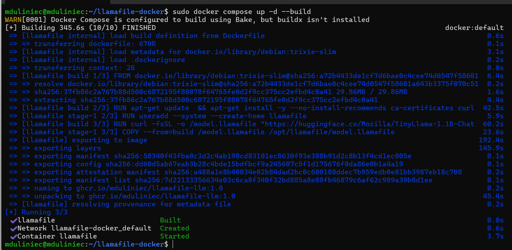

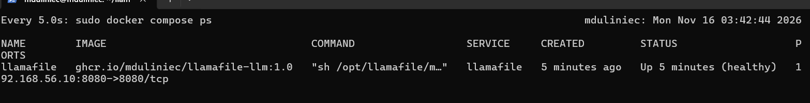

7. Weryfikacja działania i dostępności sieciowej

Użytkownik procesu w kontenerze i brak curl w obrazie końcowym

```bash
sudo docker compose exec llamafile sh -c 'id; command -v curl || echo "curl: brak w obrazie"'
```

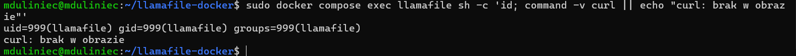

Rozmiar obrazu.

```bash
sudo docker image ls
```

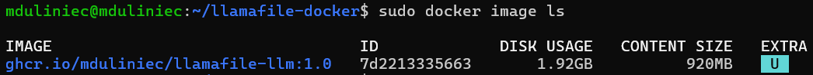

Gniazda nasłuchujące

```bash
sudo ss -tlnp | grep 8080
```

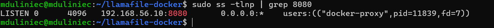

Brak dostępu do API pod pozostałymi adresami

```bash
curl -m 3 http://10.0.2.15:8080/health
curl -m 3 http://192.168.1.15:8080/health
```

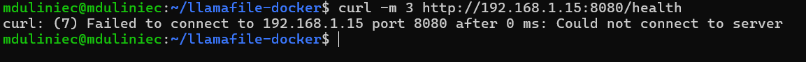

Dostępność API z komputera-gospodarza

```bash
curl.exe 192.168.56.10:8080/health
```

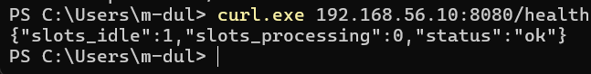

8. Logowanie do GitHub Container Registry

```bash
read -rs GHCR_TOKEN
echo "$GHCR_TOKEN" | sudo docker login ghcr.io -u MDuliniec --password-stdin
unset GHCR_TOKEN
```

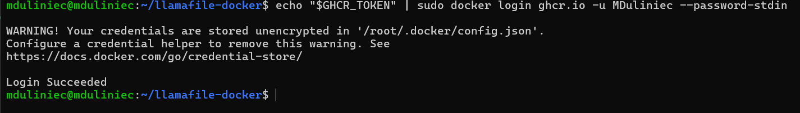

9. Wypchnięcie obrazu do rejestru

```bash
sudo docker compose push
```

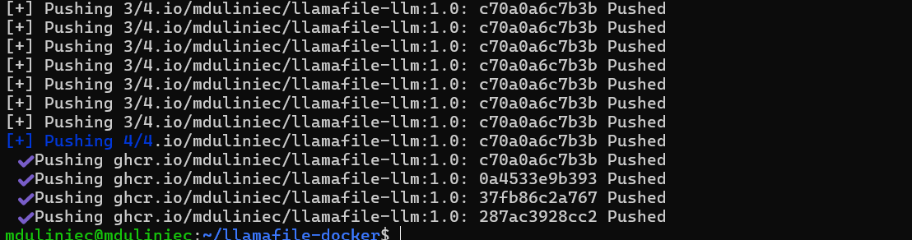

Weryfikacja w rejestrze. Na stronie profilu GitHub, w zakładce Packages, widoczny jest pakiet llamafile-llm z tagiem 1.0.

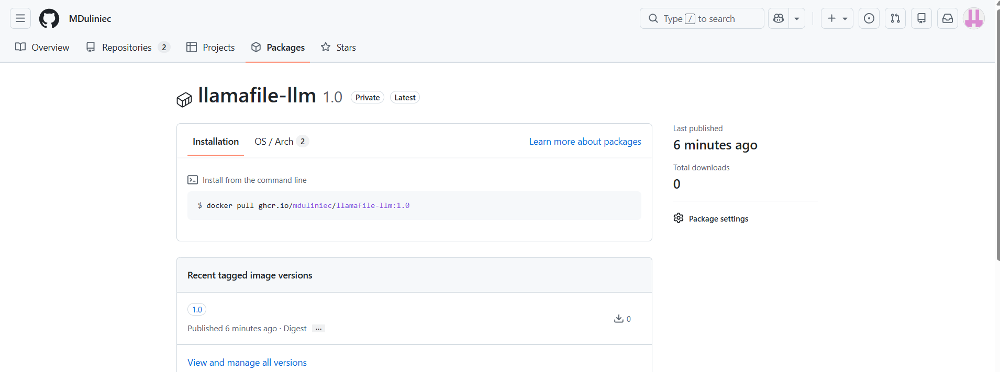

10. Ponowne uruchomienie kontenera po `kill`

Stan kontenera przed zabiciem procesu

```bash
sudo docker inspect -f 'Status={{.State.Status}} RestartCount={{.RestartCount}}' llamafile
```

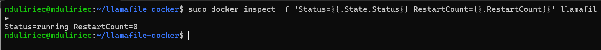

Po zabiciu procesu

```bash
sudo docker inspect -f '{{.State.Pid}}' llamafile
sudo kill -9 11798
sudo docker inspect -f 'Status={{.State.Status}} RestartCount={{.RestartCount}}' llamafile
```

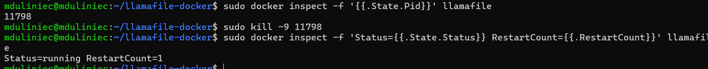

Powrót do healthy

```bash
sudo docker compose ps
```

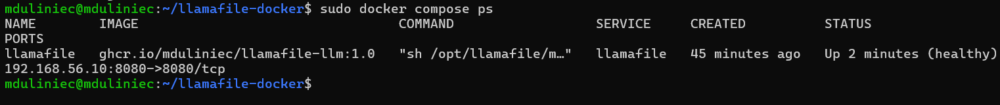

11. Test restartu maszyny

Autostart usług przed restartem

```bash
systemctl is-enabled docker
systemctl is-enabled llamafile
```

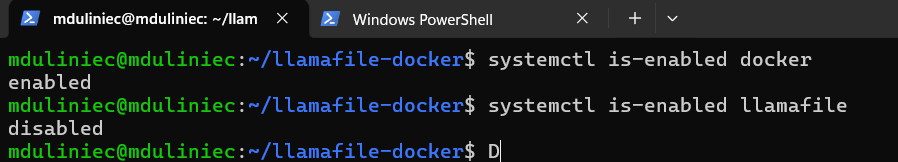

Ponowne uruchomienie maszyny i stan usługi po restarcie

```bash
sudo reboot
#Ponowne łączenie po ssh
uptime -p
cd ~/llamafile-docker
sudo docker compose ps
systemctl is-active llamafile
curl -s 192.168.56.10:8080/health
```

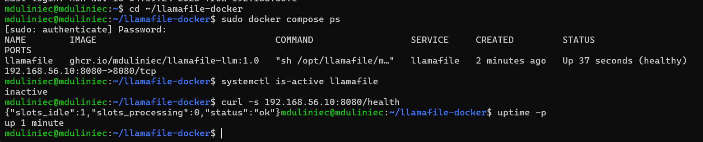

12. Test „nowej maszyny” – pobranie obrazu z rejestru

Usunięcie lokalnego obrazu i ponowne pobranie go z GHCR bez budowania.

```bash
sudo docker image ls
sudo docker compose down --rmi all
sudo docker image ls
time sudo docker compose pull
sudo docker compose up -d --no-build
sudo docker compose ps
curl -s 192.168.56.10:8080/health
```

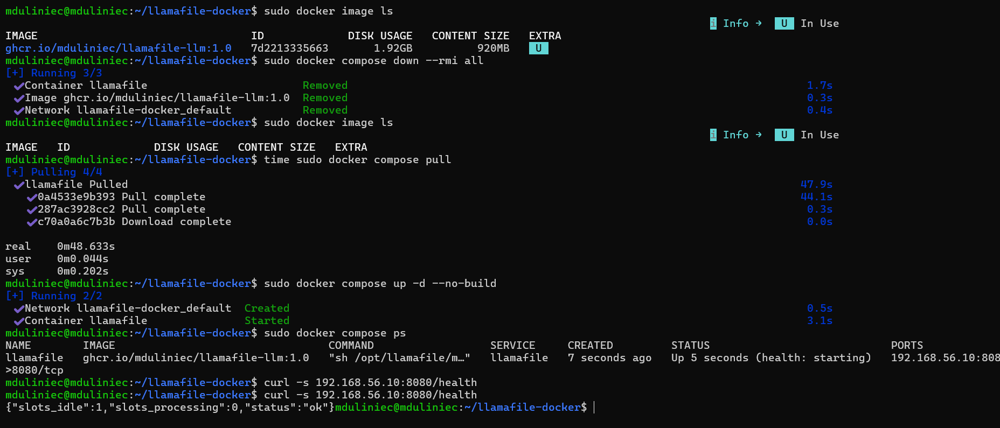

13. Przykładowe zapytanie do modelu (REST API)

```bash
curl -s http://192.168.56.10:8080/v1/chat/completions \
  -H 'Content-Type: application/json' \
  -d '{"model":"tinyllama","messages":[{"role":"user","content":"Przedstaw się w jednym zdaniu."}],"max_tokens":64}'
```

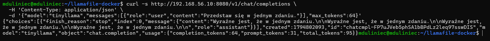

14. Pomiar czasu uruchomienia (trzykrotnie)

```bash
sudo docker compose down
time (sudo docker compose up -d; until curl -sf http://192.168.56.10:8080/health >/dev/null; do sleep 0.2; done)
```

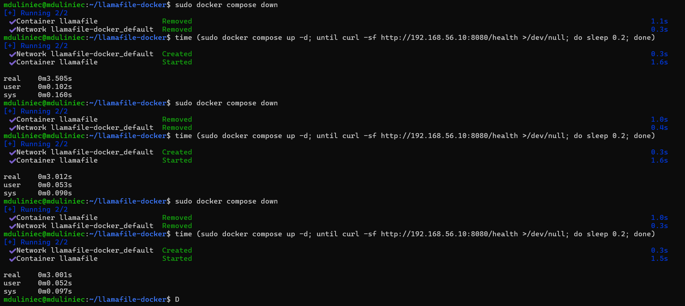

Trzy pomiary: 3,505 s, 3,012 s i 3,001 s; średnio 3,17 s.

15. Pomiary: pamięć i rozmiar obrazu kontenera

```bash
curl -s http://192.168.56.10:8080/v1/chat/completions \
    -H 'Content-Type: application/json' \
    -d '{"model":"tinyllama","messages":[{"role":"user","content":"Przedstaw się w jednym zdaniu."}],"max_tokens":64}' >/dev/null
sudo docker stats --no-stream llamafile
sudo docker image ls
```

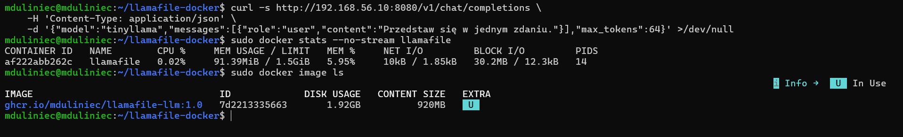

16. Pomiary: systemd

```bash
sudo docker compose down
systemctl show llamafile -p ExecStart --value | grep -o '/[^ ;]*\.llamafile' | sort -u | xargs ls -lh
for i in 1 2 3; do sudo systemctl stop llamafile; sleep 2; time (sudo systemctl start llamafile; until curl -sf http://192.168.56.10:8080/health >/dev/null; do sleep 0.2; done); done
curl -s http://192.168.56.10:8080/v1/chat/completions \
    -H 'Content-Type: application/json' \
    -d '{"model":"tinyllama","messages":[{"role":"user","content":"Przedstaw się w jednym zdaniu."}],"max_tokens":64}' >/dev/null
systemctl status llamafile --no-pager | grep -E 'Memory|Active'
sudo systemctl stop llamafile
sudo docker compose up -d
sleep 40
sudo docker compose ps
systemctl is-enabled llamafile
```

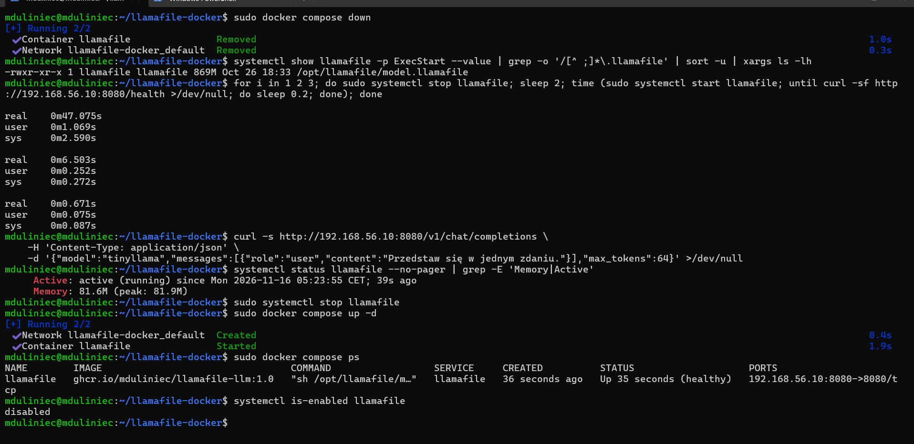

Oba warianty używają portu 8080, więc na czas pomiaru kontener był zatrzymany, a po pomiarach przywrócony. 

Rozmiar pliku llamafile: 869 MB. 

Czas startu mierzony trzykrotnie: 47,075 s, 6,503 s, 0,671 s; średnia 18,08 s. 

Pierwszy pomiar jest najdłuższy, bo plik modelu musiał zostać wczytany z dysku, kolejne są szybsze dzięki pamięci podręcznej systemu. 

Zużycie pamięci po jednym zapytaniu do modelu: 81,6 MB (szczyt 81,9 MB). 

Po pomiarach jednostka systemd została zatrzymana i pozostaje wyłączona (disabled), a kontener działa i jest healthy.

17. Tabela porównawcza: systemd vs kontener

| Kryterium | systemd | Kontener Docker |
| :--- | :---: | :---: |
| Miejsce na dysku | 869 MB (plik llamafile) | 1,92 GB na dysku (920 MB pobrane z rejestru) |
| Czas do pierwszej odpowiedzi | 47,08 s / 6,50 s / 0,67 s (średnia 18,08 s) | 3,50 s / 3,01 s / 3,00 s (średnia 3,17 s) |
| Zużycie pamięci po 1 zapytaniu | 81,6 MB (szczyt 81,9 MB) | 91,39 MiB (limit 1,5 GiB) |
| Liczba kroków na nowej maszynie | 8 | 6 |

18. Uzasadnienie wyboru: wagi modelu w obrazie oraz limity zasobów

Wagi modelu są częścią obrazu. Plik llamafile (silnik i wagi) jest pobierany podczas budowania i kopiowany do obrazu. Wybrałem to, bo dzięki temu na nowej maszynie wystarczy jedno `docker compose pull` i nie trzeba ręcznie pobierać pliku. 

Wada: obraz jest duży (920 MB) i przy zmianie modelu trzeba go zbudować od nowa.

Limity dobrałem na podstawie zadania 2. Tam na model przyjęto ok. 1 GB RAM-u, a usługa zużywała 81,6 MB po jednym zapytaniu. W kontenerze wyszło 91,39 MiB. Limit pamięci 1,5 GiB (1536m) daje spory zapas. Limit procesorów 2.0 odpowiada dwóm wątkom modelu. Maszyna ma 4 procesory, więc reszta zostaje dla systemu.
