# Klaster Kubernetes (k3s) z usługą LLM

## 1. Stan wyjściowy

```bash
ip -br a
docker ps
kubectl get nodes -o wide
kubectl get pods -A
```

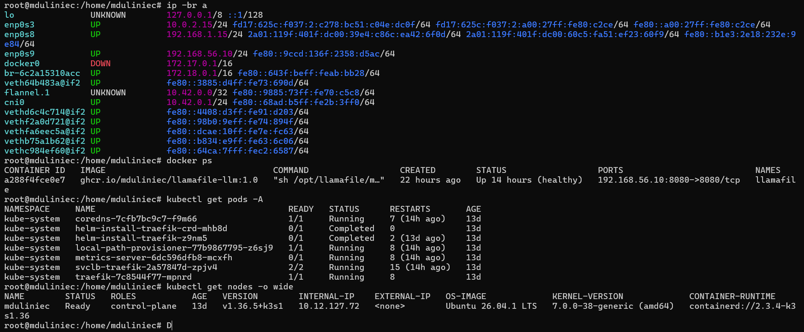

## 2. Pomiary dla docker compose

- Pamięć usługi (`docker stats --no-stream`): 64,63 MiB przy limicie 1,5 GiB (4,21%), CPU 0,03%.

- Pamięć systemu zarządzającego (RSS): `dockerd` 57748 KB + `containerd` 36052 KB = 93800 KB (ok. 91,6 MiB).

- Czas od `docker compose up` do gotowości (`time docker compose up -d --wait`): 16,1 s.

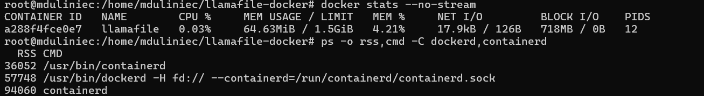

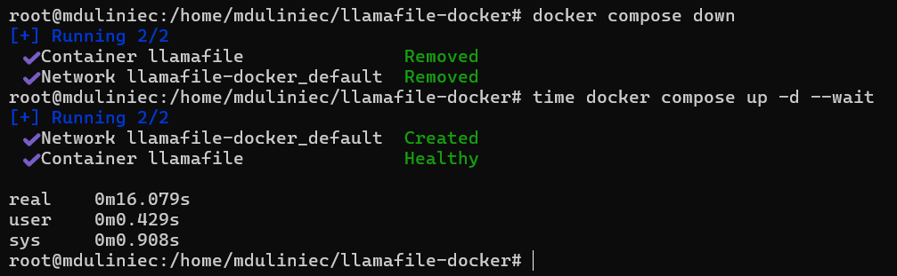

## 3. Zatrzymanie usługi docker compose, aby zwolnić port 8080

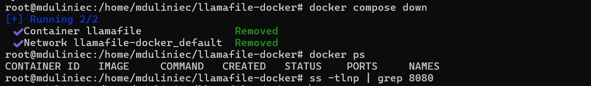

## 4. Instalacja k3s

Zainstalowano k3s skryptem instalacyjnym: `curl -sfL https://get.k3s.io | sh -`.

- `node-ip` i `advertise-address`: węzeł używa adresu host-only 192.168.56.10,
- `flannel-iface: enp0s9`: ruch sieci Podów idzie przez interfejs host-only,
- `disable: traefik, servicelb`: wyłączone zbędne składniki (mniej pamięci i brak portów 80/443 na wszystkich interfejsach),
- `kube-proxy-arg: nodeport-addresses=192.168.56.10/32`: porty NodePort nasłuchują tylko na adresie host-only (domyślnie na wszystkich),

```
node-ip: 192.168.56.10
advertise-address: 192.168.56.10
flannel-iface: enp0s9
write-kubeconfig-mode: "644"
disable:
  - traefik
  - servicelb
kube-proxy-arg:
  - "nodeport-addresses=192.168.56.10/32"
```

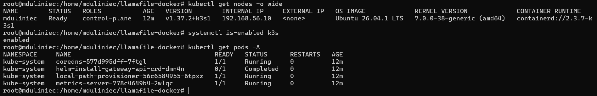

## 5. Import obrazu do klastra

k3s używa własnego środowiska uruchomieniowego (containerd), które nie widzi obrazów z Dockera. Obraz z Pracowni 3 zaimportowano poleceniem `docker save ... | sudo k3s ctr images import -`.

Do testu aktualizacji przygotowano drugą wersję obrazu, `1.1`, zbudowaną na bazie `1.0` z dodaną etykietą `version="1.1"`:
`printf 'FROM ghcr.io/mduliniec/llamafile-llm:1.0\nLABEL version="1.1"\n' | docker build -t ghcr.io/mduliniec/llamafile-llm:1.1 -`

```bash
docker image ls | grep llamafile
printf 'FROM ghcr.io/mduliniec/llamafile-llm:1.0\nLABEL version="1.1"\n' | docker build -t ghcr.io/mduliniec/llamafile-llm:1.1 -
docker save ghcr.io/mduliniec/llamafile-llm:1.0 | sudo k3s ctr images import -
docker save ghcr.io/mduliniec/llamafile-llm:1.1 | sudo k3s ctr images import -
sudo k3s ctr images ls | grep llamafile
```

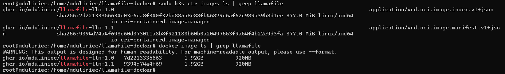

## 6. Pliki konfiguracyjne

- configmap.yaml

```bash
apiVersion: v1
kind: ConfigMap
metadata:
  name: llm-config
data:
  PORT: "8080"
  THREADS: "2"
```

- service.yaml

```bash
apiVersion: v1
kind: Service
metadata:
  name: llm
spec:
  type: NodePort
  selector:
    app: llm
  ports:
    - port: 8080
      targetPort: http
      nodePort: 30080
```

- deployment.yaml

```bash
apiVersion: apps/v1
kind: Deployment
metadata:
  name: llm
spec:
  replicas: 1
  strategy:
    type: RollingUpdate
    rollingUpdate:
      maxSurge: 1
      maxUnavailable: 0
  selector:
    matchLabels:
      app: llm
  template:
    metadata:
      labels:
        app: llm
    spec:
      containers:
        - name: llm
          image: ghcr.io/mduliniec/llamafile-llm:1.0
          imagePullPolicy: IfNotPresent
          args: ["--port", "$(PORT)", "-t", "$(THREADS)"]
          envFrom:
            - configMapRef:
                name: llm-config
          ports:
            - name: http
              containerPort: 8080
          securityContext:
            runAsNonRoot: true
            runAsUser: 999
            allowPrivilegeEscalation: false
          resources:
            requests:
              memory: "128Mi"
              cpu: "500m"
            limits:
              memory: "1536Mi"
              cpu: "2"
          startupProbe:
            httpGet:
              path: /health
              port: http
            periodSeconds: 5
            failureThreshold: 60
          readinessProbe:
            httpGet:
              path: /health
              port: http
            periodSeconds: 5
          livenessProbe:
            httpGet:
              path: /health
              port: http
            periodSeconds: 15
            failureThreshold: 3
```

## 7. Uruchomienie usługi
Usługę uruchomione poleceniem `kubectl apply -f k8s/`. Pod po utworzeniu przeszedł przez stan `Running` z `0/1` (model w trakcie ładowania, `startupProbe` jeszcze nie zakończona), a dopiero po jej sukcesie stał się gotowy (`1/1`) i został dołączony do Service.

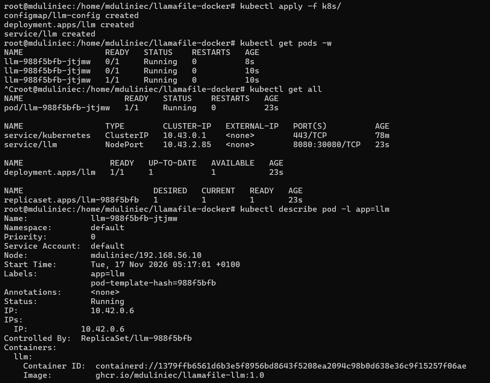

## 8. Zapytanie do API

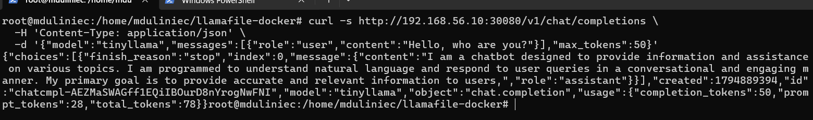

## 9. Dostępność API tylko pod adresem host-only

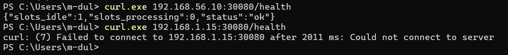

## 10. Samoleczenie

Po usunięciu Poda poleceniem `kubectl delete pod` Deployment (przez ReplicaSet) automatycznie utworzył nowy Pod

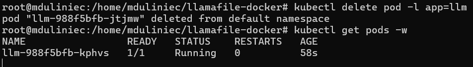

## 11. Autostart po restarcie
k3s działa jako usługa systemd (`enabled`), więc po restarcie VM klaster startuje sam i odtwarza Deployment z zapisanego stanu.

Stan usługi po restarcie:

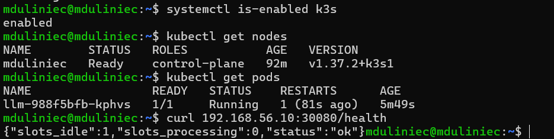

## 12. Aktualizacja do nowej wersji obrazu

W trakcie aktualizacji w drugim terminalu działała pętla `curl` odpytująca `/health` co 0,5 s. 

Aktualizację wykonano poleceniem `kubectl set image deploy/llm llm=ghcr.io/mduliniec/llamafile-llm:1.1`. Dzięki `maxUnavailable: 0` stary Pod obsługiwał ruch, dopóki nowy nie przeszedł `startupProbe` i `readinessProbe`.

Wycinek pętli `curl` z czasu aktualizacji (same kody 200, brak przerwy):

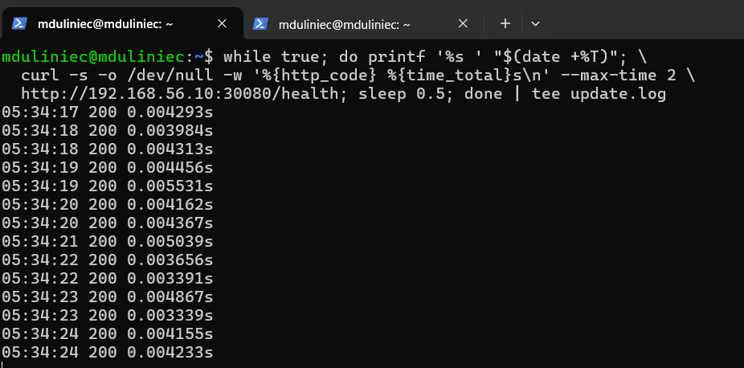

Przebieg (`get pods -w`, `rollout status`, `rollout history`):

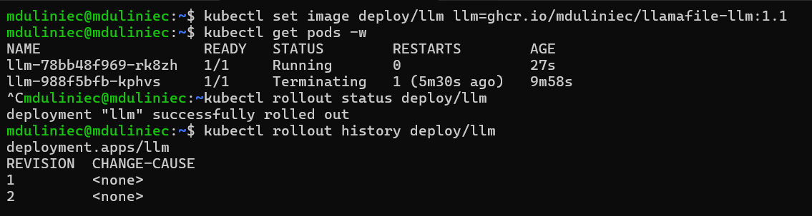

## 13. Wadliwe wdrożenie i wycofanie

Wdrożono obraz o nieistniejącym tagu. Nowy Pod nie mógł pobrać obrazu (`ErrImagePull`), natomiast dotychczasowy Pod nadal działał i obsługiwał zapytania, ponieważ Deployment nie usuwa starego Poda, dopóki nowy nie jest gotowy.

Stan w trakcie awarii:

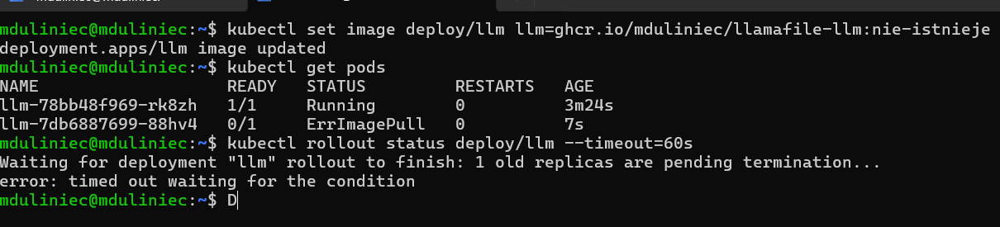

Wycofanie poleceniem `kubectl rollout undo deploy/llm`:

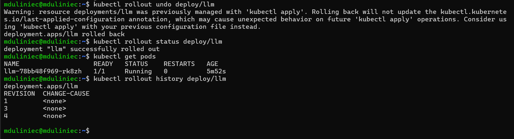

## 14. Zużycie zasobów i czas uruchomienia w k3s

- `kubectl top pod`:

      NAME                  CPU(cores)      Memory(bytes)
      llm-988f5bfb-4p7nr    7m              60Mi

- `kubectl top node`:

      NAME        CPU(cores)   CPU(%)   MEMORY(bytes)   MEMORY(%)
      mduliniec   395m         9%       1215Mi          35%

- RSS procesu `k3s-server`: `615928 KB`
- Czas od `kubectl apply` do pierwszej odpowiedzi: `2 s`

## 15. Porównanie: docker compose a k3s

| Kryterium | docker compose | k3s |
|---|---|---|
| Pamięć usługi | 64,63 MiB (w spoczynku) | 60 Mi |
| Pamięć systemu zarządzającego | 91,6 MiB (`dockerd` + `containerd`) | 601,5 MiB (`k3s-server`, 615928 KB) |
| Czas od uruchomienia do pierwszej odpowiedzi | 16,1 s | 2 s |
| Liczba kroków na nowej maszynie | 4 (instalacja Dockera, klon repozytorium, plik `.env`, `docker compose up --build`) | 5 (konfiguracja i instalacja k3s, import obrazu, klon repozytorium, `kubectl apply -f k8s/`) |

**Wnioski:** Docker compose jest wyraźnie lżejszy: sam system zarządzający zajmuje ok. 92 MiB, a k3s ok. 600 MiB, czyli ponad sześć razy więcej, przy zbliżonym zużyciu pamięci przez samą usługę. 

Za ten koszt k3s dał mechanizmy, które w compose trzeba by robić ręcznie: aktualizacja obrazu przebiegła bez przerwy w odpowiedziach `curl`, po usunięciu Poda klaster sam utworzył nowy, a wadliwe wdrożenie z nieistniejącym tagiem nie wyłączyło działającej wersji i dało się je cofnąć jednym poleceniem `rollout undo`. 

Dla pojedynczej usługi na jednej maszynie compose w zupełności wystarcza, a k3s ma sens, gdy ważna jest ciągłość działania i bezpieczne wdrażanie zmian.
